<picture><source media="(max-width: 600px) and (prefers-reduced-motion: reduce)" srcset="assets/v4/hero-mobile-still.svg"><source media="(max-width: 600px)" srcset="assets/v4/hero-mobile.svg"><source media="(prefers-reduced-motion: reduce)" srcset="assets/v4/hero-still.svg">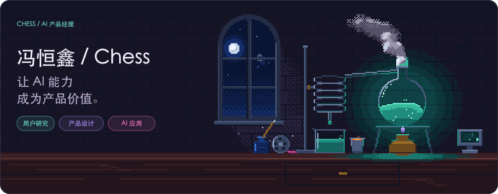</picture>

<a href="https://haidarkhanuk3344-collab.github.io/"><picture><source media="(prefers-reduced-motion: reduce)" srcset="assets/v4/links/portfolio-still.svg"></picture></a>

你好，我是 **冯恒鑫 / Chess**，一名 **AI 产品经理**。关注用户需求、AI 能力与产品体验的连接，将复杂问题转化为清晰、可落地的产品方案。

以 **场景研究、需求定义与产品设计** 为起点，结合 AI 能力评估、交互设计与体验迭代，推动技术能力转化为用户价值。

[全部项目](https://github.com/haidarkhanuk3344-collab?tab=repositories) · [我的个人空间](https://haidarkhanuk3344-collab.github.io/)

## 精选项目

<table>
<tr>
<td width="50%" valign="top">
<a href="https://github.com/haidarkhanuk3344-collab/haixin-agent"><picture><source media="(prefers-reduced-motion: reduce)" srcset="assets/v4/anode-still.svg">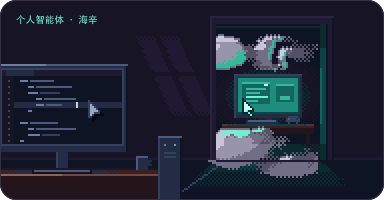</picture></a>
<h3><a href="https://github.com/haidarkhanuk3344-collab/haixin-agent">海辛 · 个人智能体</a></h3>

把聊天、记忆、资料阅读、日程和提醒接在同一条对话里。围绕个人背景持续跟进事项，让对话连接到具体的行动与成果。

<strong>OpenClaw · DeepSeek · Python · React</strong>

</td><td width="50%" valign="top">
<a href="https://github.com/haidarkhanuk3344-collab/contextflow"><picture><source media="(prefers-reduced-motion: reduce)" srcset="assets/v4/inkbolt-still.svg">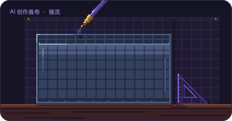</picture></a>
<h3><a href="https://github.com/haidarkhanuk3344-collab/contextflow">镜流 · AI 创作画布</a></h3>

让下一镜头，听懂「承接上一镜头」。在同一张画布里组织图像、视频与素材，通过指定前序结果传递文字和视觉上下文。

<strong>React · TypeScript · Node.js · FFmpeg</strong>

</td>
</tr>
<tr>
<td width="50%" valign="top">
<a href="https://github.com/haidarkhanuk3344-collab/world-tree"><picture><source media="(prefers-reduced-motion: reduce)" srcset="assets/v4/cutbolt-still.svg">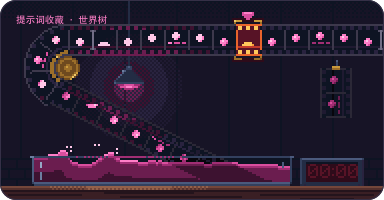</picture></a>
<h3><a href="https://github.com/haidarkhanuk3344-collab/world-tree">世界树 · 提示词库</a></h3>

一条提示词，一枚果实。把收藏、查找、编辑与复制，放进一棵可以旋转探索的三维树。让积累也带一点探索感，提示词保存在本地浏览器中。

<strong>Three.js · WebGL · JavaScript · 本地存储</strong>

</td><td width="50%" valign="top">
<a href="https://github.com/haidarkhanuk3344-collab/brave-journey"><picture><source media="(prefers-reduced-motion: reduce)" srcset="assets/v4/pixelbolt-still.svg">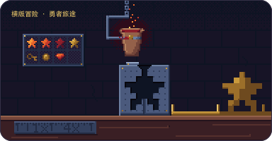</picture></a>
<h3><a href="https://github.com/haidarkhanuk3344-collab/brave-journey">勇者旅途 · 2D 横版冒险</a></h3>

围绕探索、战斗与成长展开的横版冒险。以战士、射手、法师三种职业，串起城镇、关卡、技能与装备系统，让每一次挑战都有新的选择。

<strong>JavaScript · Canvas 2D · HTML · CSS</strong>

</td>
</tr>
</table>

**[Page Simplify](https://github.com/haidarkhanuk3344-collab/page-simplify)** — 页面精简 Skill：保留设计巧思，减少冗余内容，校准视觉层级与对齐。

**[复古电视交互页](https://haidarkhanuk3344-collab.github.io/iqiyi-interactive-showcase/)** — 以电视开屏、频道切换和滚动叙事，构建具有场景感的内容浏览体验。

## 产品设计实践

| 项目 | 产品关注点 |
| --- | --- |
| [镜流](https://github.com/haidarkhanuk3344-collab/contextflow) | 创作任务拆解、上下文承接与生成流程中的信息组织。 |
| [海辛](https://github.com/haidarkhanuk3344-collab/haixin-agent) | 个人背景记忆、事项跟进与对话到行动的衔接。 |
| [世界树](https://github.com/haidarkhanuk3344-collab/world-tree) | 空间化知识组织、内容查找与交互可发现性。 |
| [勇者旅途](https://github.com/haidarkhanuk3344-collab/brave-journey) | 职业差异、战斗反馈与角色成长的体验设计。 |

## 项目入口

<a href="https://haidarkhanuk3344-collab.github.io/contextflow/"><picture><source media="(prefers-reduced-motion: reduce) and (max-width: 374px)" srcset="assets/v4/links/world-language-map-narrow-still.svg"><source media="(max-width: 374px)" srcset="assets/v4/links/world-language-map-narrow.svg"><source media="(prefers-reduced-motion: reduce)" srcset="assets/v4/links/world-language-map-still.svg"></picture></a>
<a href="https://github.com/haidarkhanuk3344-collab/haixin-agent"><picture><source media="(prefers-reduced-motion: reduce) and (max-width: 374px)" srcset="assets/v4/links/export-atlas-narrow-still.svg"><source media="(max-width: 374px)" srcset="assets/v4/links/export-atlas-narrow.svg"><source media="(prefers-reduced-motion: reduce)" srcset="assets/v4/links/export-atlas-still.svg">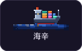</picture></a>
<a href="https://github.com/haidarkhanuk3344-collab/brave-journey"><picture><source media="(prefers-reduced-motion: reduce) and (max-width: 374px)" srcset="assets/v4/links/london-in-minutes-narrow-still.svg"><source media="(max-width: 374px)" srcset="assets/v4/links/london-in-minutes-narrow.svg"><source media="(prefers-reduced-motion: reduce)" srcset="assets/v4/links/london-in-minutes-still.svg">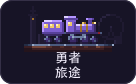</picture></a>
<a href="https://github.com/haidarkhanuk3344-collab/world-tree"><picture><source media="(prefers-reduced-motion: reduce) and (max-width: 374px)" srcset="assets/v4/links/chinese-touch-typing-narrow-still.svg"><source media="(max-width: 374px)" srcset="assets/v4/links/chinese-touch-typing-narrow.svg"><source media="(prefers-reduced-motion: reduce)" srcset="assets/v4/links/chinese-touch-typing-still.svg">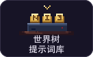</picture></a>
<a href="https://github.com/haidarkhanuk3344-collab/page-simplify"><picture><source media="(prefers-reduced-motion: reduce) and (max-width: 374px)" srcset="assets/v4/links/chinese-radicals-narrow-still.svg"><source media="(max-width: 374px)" srcset="assets/v4/links/chinese-radicals-narrow.svg"><source media="(prefers-reduced-motion: reduce)" srcset="assets/v4/links/chinese-radicals-still.svg">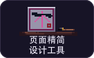</picture></a>
<a href="https://haidarkhanuk3344-collab.github.io/iqiyi-interactive-showcase/"><picture><source media="(prefers-reduced-motion: reduce) and (max-width: 374px)" srcset="assets/v4/links/keepsake-narrow-still.svg"><source media="(max-width: 374px)" srcset="assets/v4/links/keepsake-narrow.svg"><source media="(prefers-reduced-motion: reduce)" srcset="assets/v4/links/keepsake-still.svg">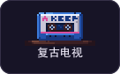</picture></a>

## 产品方法

从用户场景与任务链路识别问题，围绕价值、AI 能力边界与体验成本做取舍。通过需求拆解、交互设计和迭代反馈，让产品方案具备清晰的落地路径。

### 技术与工具

<strong>AI 与智能体</strong>

  
  
  
  

<strong>界面与交互</strong>

  
  
  
  

<strong>开发与本地运行</strong>

  
  
  
  

 

<picture><source media="(prefers-reduced-motion: reduce)" srcset="assets/v4/footer-still.svg">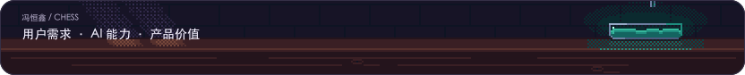</picture>
